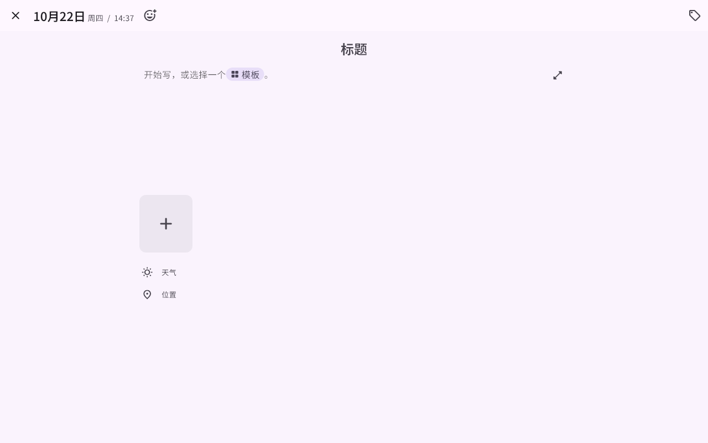

# AID Diary

[English](README.md) | **简体中文** | [日本語](README.ja.md) | [한국어](README.ko.md)

一款用 Flutter 写的私人日记应用，支持 Windows 和 Android。

AID Diary 是 Demizo 等人的 [Daily You](https://github.com/Demizo/Daily_You)（GPL-3.0）的修改版，**不是** Daily You 官方应用。上游版本和许可证见 [SOURCE.md](SOURCE.md)。

最新 `main` 的构建在 [nightly 预发布版本](https://github.com/playeriv65/AID-AIDiary/releases/tag/nightly)里（Android APK 和 Windows 压缩包）。它们用调试密钥签名，可以全新安装，但不能覆盖用正式密钥签名的安装。

本文是精简版；完整的功能说明以[英文 README](README.md) 为准，开发文档也是英文。

## 截图

| 平板 / 电脑 | 手机 |
|---|---|
|  |   |
|  |   |
|  |   |

## 主要功能

- **日记**：按天分组的日记卡片，显示时间、标题、摘要、心情、地点、天气和标签；上方是"今天"、那年今日、随机漫步、周/年回顾等故事卡片。
- **日记日**：每篇日记同时记录写下的时间和它属于哪一天。凌晨写的默认算前一天，可以随时修改日记日而不改写作时间。
- **编辑器**：标题可选，支持 Markdown、照片、视频、语音、手写；新日记自动填地点和天气。
- **评论与引用**：读过往日记时选中一段文字，可以收藏这段或评论它，也可以评论整篇。评论就是一篇今天的日记，引用它回应的原文；短评论写几行即可，也可以展开成完整编辑。任何日记都能引用别的日记，日记下方会列出回应它的日记。
- **日历**：在日记页原地展开，点某一天，列表翻到那一天。
- **地图**：在 OpenStreetMap 上显示带地点的日记；一个点有多篇时点开是这一批日记的列表。
- **标签**：新日记本没有预置标签；标签顺序由你长按拖动决定，日记卡片上直接显示标签名。
- **照片**：默认保存原图；可以选择把新照片存成约 1 MB 的 WebP，也可以一次性压缩已有照片（不可恢复）。
- **隐藏日记**：在"设置 › 安全"里本地验证后查看，不出现在普通列表、搜索、小组件和导出中，同步后在其他设备上同样隐藏。
- **同步（可选）**：始终端到端加密，没有日记账号和密码。可用你自己的 Google Drive、WebDAV（坚果云、Nextcloud、群晖等）或 `server/` 里的 AID 同步服务器；同一网络下的设备直接传输。新设备通过配对码或扫码加入，丢失全部设备时用恢复码找回。
- **导入导出**：可导入一本日记 v3 备份、Journey、Day One、Daylio 等；可导出 JSON、Markdown、Journey 和 Day One 格式，以及完整备份。
- **命令行**：应用里的每个功能都是一个动作，按钮、命令面板和 `aid` 命令行共用同一套，脚本或 AI 助手做的事会实时显示在应用里。
- **Android 桌面小组件**：今日状态、每日照片、连续天数、写作提示和快速心情。

## 隐私与联网

日记、照片和坐标都保存在设备上；只有打开同步后，才会加密发送到你选择的存储和受信任的设备。以下联网都是可选的，地址配置在 [assets/config/app_config.json](assets/config/app_config.json)：

- OpenStreetMap 地图瓦片，以及 Nominatim 地名查询。
- Overpass 查询附近的地点（打开地点选择器时）。
- Open-Meteo 天气（只发送坐标和日期）。
- 用 Google Drive 同步时的 Google 登录和 Drive API。

## 开发

主要在 Windows 上开发。从[文档索引](docs/INDEX.md)和[交接说明](docs/HANDOFF.md)开始；[环境搭建](docs/SETUP.md)介绍新电脑上的工具链、签名和测试设备。常用命令见[英文 README](README.md#development)。

## 许可证

GPL-3.0-only（[LICENSE.txt](LICENSE.txt)），附加条款见 [ADDITIONAL_TERMS.md](ADDITIONAL_TERMS.md)。
